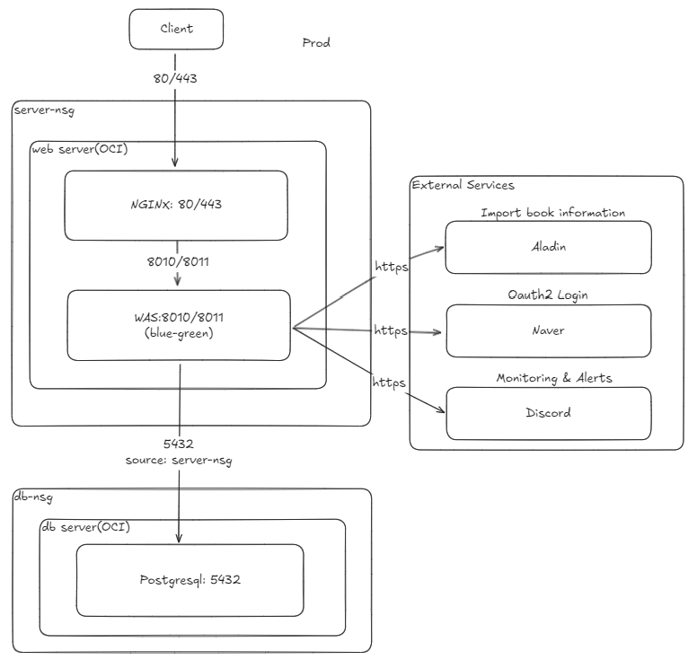

# 📚 BookTalker

> 같은 책을 다시 읽을 때마다 독후감을 남기고, 독서 모임 안에서 나누는 서비스


**서비스** https://booktalker.co.kr · **포트폴리오** https://wiry-cress-f67.notion.site/Booktalker-3b3b51ad86d980fba4a9c96c7751d852

<br>

## 프로젝트 소개

BookTalker는 책을 읽고 난 뒤의 생각을 **회독 단위로 기록**하고, 원하는 범위(전체·모임·나만)로 나눌 수 있는 서비스입니다.

- 같은 책을 두 번, 세 번 읽으면 그때마다 새 독후감을 남겨 생각이 어떻게 바뀌었는지 볼 수 있습니다.
- 독서 모임을 만들고 초대 링크로 모임원을 모아, 모임원끼리 독후감을 모아 볼 수 있습니다.
- **2026년 10월부터 실제 독서 모임에서 사용 중**입니다.

1GB 메모리 서버 한 대(OCI Free Tier)에서 배포·운영까지 직접 하고 있습니다.

<br>

## 주요 기능

### 📝 독후감
- 회독 수 기반 작성: 1회독 작성과 다음 회독 작성을 별도 API로 분리
- 공개 범위 선택: 전체공개 / 모임공개 / 비공개 (회차와 관계없이 선택·변경 가능)
- 한 줄 요약(`headline`)은 항상 공개, 본문은 공개 범위에 따라 노출

### 👥 독서 모임
- 모임 생성, 초대 링크(코드)로 가입 — 가입 전 모임 미리보기, 로그인 후 초대 링크로 복귀
- 모임원 목록, 모임 피드(모임원의 전체공개·모임공개 독후감), 모임 독후감 상세

### 🏆 랭킹
- 매일 새벽 4시 배치로 전체·장르별 랭킹 집계
- 베이즈 추정 가중 평점, 1회독 리뷰만 집계, 리뷰 3건 이상인 책만 포함

### 🔍 책 검색 · 🔐 로그인
- 알라딘 API 기반 책 검색
- 네이버 OAuth2 로그인 (회원가입 없음)

<br>

## 시스템 아키텍처



- WAS 서버(RAM 1GB)와 DB 서버를 분리. DB 서버는 외부에 SSH(22)만 열고, 5432는 WAS 서버 NSG에서 오는 요청만 허용 (운영자 DB 접속은 SSH 터널)
- Nginx가 Vue3 정적 파일을 서빙하고, API 요청은 WAS로 리버스 프록시
- WAS는 배포 때 8010 ⇄ 8011 포트를 교대하며 무중단 전환

### 배포 흐름

```
main push → GitHub Actions 빌드 → jar 전송 → deploy.sh
  ├─ 기존 버전을 둔 채 새 버전을 다른 포트에 기동
  ├─ 헬스체크 반복 → 성공 시 Nginx 전환, 기존 버전 종료
  ├─ 실패 시 새 버전 종료(자동 롤백) · Discord 알림 · exit 1
  └─ Actions 마지막 단계에서 실제 도메인(HTTPS)으로 한 번 더 헬스체크
```

- 스키마 변경은 Flyway 마이그레이션 파일로만 (`ddl-auto: validate`)
- 운영 비밀값은 서버 환경변수 파일에서 주입, 저장소에는 없음

<br>

## 기술 스택

| 영역 | 기술 |
|------|------|
| Backend | Java 17, Spring Boot 3.x, Spring Security, Spring Data JPA, Spring Scheduler |
| Database | PostgreSQL, Flyway |
| Frontend | Vue3, PWA |
| Infra · 배포 | OCI Free Tier (WAS·DB 서버 분리), Nginx, GitHub Actions |
| 운영 | Logback (프로파일별 분리), Discord Webhook Appender, Spring Boot Actuator |
| Test | JUnit 5, Testcontainers |
| External API | 알라딘 API, Naver OAuth2 |

<br>

## 주요 문제 해결

### 1. 1GB 서버 무중단 배포 장애 → 실측으로 배포 구조 결정
독서 모임 기능 배포 직후 새 버전이 뜨지 않았고, 배포 스크립트는 실패해도 CI에 성공으로 표시됐습니다. 추정치 대신 메모리·스왑·기동 시간을 실측해 비교한 뒤 **무중단 배포를 유지**하고, 자동 롤백·실패 감지·외부 경로 헬스체크를 넣었습니다. 배포 중 외부 요청은 모두 정상 응답했습니다.

📄 [장애 보고서](<document/infra/[incident]_1차 배포 장애 — 메모리 부족·방화벽 차단.md>) · [배포 구조 결정](<document/infra/[design]_배포 구조 결정.md>)

### 2. 랭킹 집계 배치 DB 왕복 66% 감소
리뷰 10만 건 테스트 데이터로 배치를 실측해, 저장 전 존재 확인 SELECT·건별 DELETE·건별 INSERT를 찾아 `Persistable`·벌크 삭제·JDBC 배치로 줄였습니다. 집계 쿼리는 GROUP BY 대상을 단일 테이블로 좁혀 실행 계획을 바꿨습니다.

| | 개선 전 | 개선 후 |
|---|---|---|
| 배치 1회 DB 왕복 | 242회 | 82회 (−66%) |
| 집계 쿼리 실행 시간 | 182ms | 77ms (−58%) |

📄 커밋 [`e21125b`](https://github.com/namyoungjun96/BookTalker/commit/e21125b) · [`2fd1143`](https://github.com/namyoungjun96/BookTalker/commit/2fd1143)

### 3. 이력 없이 쌓인 운영 스키마 → Flyway 전환
`ddl-auto: update`와 수동 SQL로 만들어진 운영 스키마를 `pg_dump`로 추출해 baseline으로 삼고, 엔티티와 대조해 빠져 있던 NOT NULL 제약 4개를 보강했습니다. 로컬에서 운영과 같은 경로로 리허설한 뒤 실사용 전에 적용했습니다.

📄 [Flyway 도입](<document/infra/[design]_Flyway 도입.md>) · [운영 DB 마이그레이션 (1차 배포)](<document/infra/[design]_운영 DB 마이그레이션 (팀 기능 1차 배포).md>)

<br>

## 기술적 의사결정

### 회독 단위 리뷰
같은 책을 다시 읽은 기록을 덮어쓰지 않도록 `(writer, isbn13, reading_count)` 복합 UNIQUE 제약을 두고, 1회독과 다음 회독(기존 회독이 있어야 작성 가능)을 별도 API로 나눴습니다. 서비스 사전 검증으로 친절한 오류를 주고, 동시 요청으로 제약이 발동하면 409로 응답합니다.

### 공개 범위 3단계 전환
모임 기능으로 '모임공개'라는 선택지가 생기면서, **사용자가 지정하지 않았는데도 2회독 이상을 비공개로 묶던 정책**을 없앴습니다. 독후감은 개인적인 기록이지만, 폐쇄성은 시스템이 아니라 사용자가 정해야 한다고 봤습니다. 대신 기본값은 `PRIVATE`로 두었습니다.
📄 [리뷰 visibility 전환](<document/review/[design]_리뷰 visibility 전환.md>)

### 랭킹 신뢰도
리뷰 1~2개뿐인 책이 상위에 오르거나 같은 사람의 회독별 평점이 겹치면 랭킹을 믿기 어렵습니다. 베이즈 추정 가중 평점을 쓰고, 1회독 리뷰만·리뷰 3건 이상인 책만 집계합니다.

### 모임 존재 여부 숨기기
"모임 없음"과 "모임원 아님"을 모두 404로 응답해, 모임 ID를 바꿔 넣어 다른 모임이 있는지 알아낼 수 없게 했습니다. 이미 모임원인 사용자의 권한 부족만 403으로 구분합니다.
📄 [팀 기능 의사결정 로그](<document/team/[decision]_팀 기능 의사결정.md>)

### 초대코드는 DB 제약으로
별도 테이블 대신 모임 테이블의 NOT NULL + UNIQUE 컬럼으로 저장해, "모임에는 항상 초대코드가 1개 있다"는 규칙을 DB가 보장하게 했습니다.
📄 [초대코드 설계](<document/team/[design]_초대코드 설계.md>)

### 가벼운 운영 모니터링
1GB 서버에 Prometheus·Grafana를 올리는 대신 Logback Appender를 직접 구현해 ERROR 로그를 Discord로 보내고, API 호출량·JVM Heap·커넥션 풀 상태를 매일 리포트합니다.

<br>

## 개발 문서

작업 단위마다 설계 → 승인 → 구현 → 검토 순서로 진행하며 문서를 남기고 있습니다. 그중 공개용으로 정리한 문서를 `document/`에 두었습니다.

| 폴더 | 내용 |
|------|------|
| [`document/infra/`](document/infra) | 배포 장애 보고서, 배포 구조 결정, Flyway 도입, 운영 DB 마이그레이션 |
| [`document/review/`](document/review) | 리뷰 공개 범위 전환 설계 |
| [`document/team/`](document/team) | 초대코드 설계, 팀 기능 의사결정 로그 |

> 설계 검토에 AI(Claude)를 활용합니다. 선택지와 결정 근거는 문서로 남기고, 결정과 백엔드 구현은 직접 합니다.

<br>

## 로컬 실행

```bash
# DB (PostgreSQL 16)
cd docker && docker compose up -d

# Backend — 기동 시 Flyway가 스키마 적용
cd book_talker_backend && ./gradlew bootRun

# Frontend
cd book_talker_frontend && npm install && npm run dev
```

> 로컬은 `application-local.yml` 설정으로 실행됩니다. 운영(`prod`)은 환경변수로 주입: `DB_URL`, `DB_USERNAME`, `DB_PASSWORD`, `NAVER_CLIENT_ID`, `NAVER_CLIENT_SECRET`, `ALADIN_API_KEY`, `DISCORD_WEBHOOK_URL`

<br>

## 프로젝트 배경

SI에서 3년간 공공·통신 분야 웹 서비스를 개발·운영하면서, **실제 사용자가 쓰는 서비스를 처음부터 끝까지 직접 만들고 운영해 보고 싶다**는 목표로 시작했습니다.

정책 설계·백엔드 개발부터 배포·장애 대응까지 직접 책임지면서(프론트엔드 구현은 AI 활용), 추측 대신 측정으로 판단하고 그 근거를 문서로 남기는 데 집중하고 있습니다.
